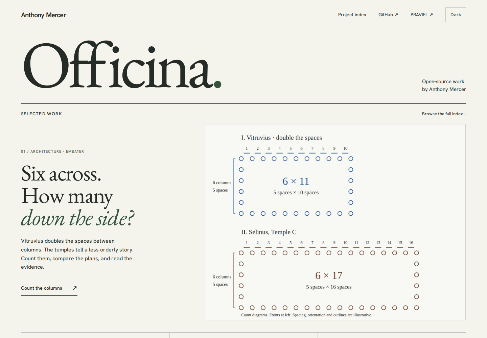

# Officina

Open-source work by Anthony Mercer.

[Browse the site](https://antonsoo.github.io/officina/) · [GitHub](https://github.com/antonsoo) · [MIT](LICENSE)



A few concrete experiments to begin with, then a searchable index of the whole
collection. The opening comparison asks why six columns across a temple do not
imply twelve down its side. Other selections open Greek octave species,
Archimedes' circle argument and a local trace reader.

The page identifies its author by name, with links to GitHub and PRAVIEL.
It does not lead with a professional title or location.

## Find something to work on

Search by project, task, source word or package registry. Select an audience to
narrow the results. Greek terms work with or without accents. Selected workshop
queries open a particular activity with its own preview and recorded review.

Typing and filtering stay in the page. **Copy search link** explicitly shares
the current query and audience; incoming links restore both. Clear filters also
clears an incoming search from the address. Failed catalogue loads have a retry.

Source and recorded-evidence links remain visible in the project index. Evidence
links point to the reviewed source revision; a demo or registry release can use a
different version. [Source update history](docs/source-history.md).

## Run locally

Node 24 or later:

```sh
git clone https://github.com/antonsoo/officina && cd officina
npm ci
npm run dev
```

```sh
npm run lint
npm run typecheck
npm run format:check
npm test
npm run test:browser
```

`npm run build` creates `dist/` with base `/officina/`. Browser checks run the
production build in Chromium and Firefox. They exercise keyboard navigation,
search, explicit sharing, retry, phone layouts, themes and accessibility.

To compare every hosted file with a local build:

```sh
npm run verify:pages -- https://antonsoo.github.io/officina/ dist --out /tmp/officina-pages.json
```

Use `node scripts/verify-pages.mjs --help` for the exact options. Source publication,
hosted byte equality and browser operation are separate checks.

## Catalogue and design

`public/projects.json` contains the project records and optional workshop routes.
Each record has a name, description, group, repository URL, demo URL (or `null`),
thumbnail and publication status. `soon` records are kept out of the rendered
index. Optional registry, study and search-term fields make the same data useful
for software tools and source-based lessons.

`src/catalogue.ts` validates the data at build time and in the browser.
`src/selected.ts` contains the deliberately small opening selection, which only
renders published projects. `src/main.ts` keeps search controls and result nodes
mounted so filtering preserves keyboard focus.

The design uses large EB Garamond type for the selected questions, Hanken Grotesk
for records and controls, olive ink and ruled rows. Screenshots come from the
actual projects. Light and dark themes follow the system or a saved manual choice.
Fonts are self-hosted under the SIL Open Font License; see
[src/fonts/LICENSE.txt](src/fonts/LICENSE.txt) and
[src/fonts/HANKEN-LICENSE.txt](src/fonts/HANKEN-LICENSE.txt).

There is no analytics or third-party asset request. The catalogue remains
filterable without a connection once loaded; links to other projects require
those destinations to be available separately.

[Aristotle discovery journeys](docs/horos-review.md) ·
[Redesign and publication review](docs/redesign-review.md) ·
[Earlier catalogue guide and study links](docs/archive/catalogue-guide-2026-10-29.md) ·
[Contributing](CONTRIBUTING.md)
