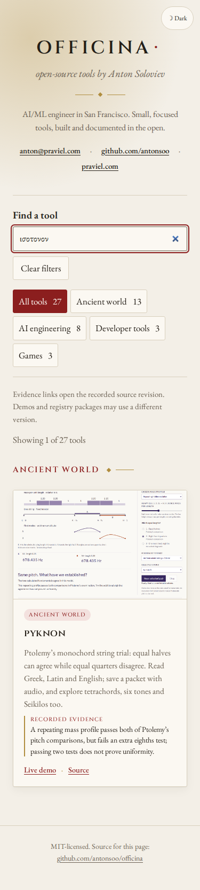

# Put the instrument on trial

Two existing projects now open their new workshops directly. The catalogue
still contains **27 projects**; these changes deepen the routes into two of them.

| Project | Direct workshop | What the visitor tests |
| --- | --- | --- |
| Pyknon | Ptolemy’s monochord examination | A repeating mass pattern passes both equal-pitch comparisons, then fails an extra eighths test |
| Stoicheia | The mesolabe transmitted under Eratosthenes’ name | Aligning one contact leaves the other independent; both must meet the ruler before the two means establish the cube edge |

Both workshops are publicly hosted. Their cards link to immutable source
reviews, with complete historical pages, explicit modern model assumptions,
and actual portable reading artifacts. The string sound is generated sine
fundamentals; the repeating mass pattern, wave equation and eighths test are
modern experiments. The mesolabe is an ideal geometric device model; physical
assembly and attainable precision remain unverified, and the attributed letter’s
authenticity is not settled by the exhibit.

## Find the source word

The old public catalogue returned no cards for `ισοτονον` or `two mean
proportionals`, reproduced in Chromium and Firefox at 1280 and 375 pixels;
[before-search receipt](evidence/ancient-examinations-2026-10-24/before-search.json).

Optional `searchTerms` now index verified source words and lesson names in
addition to the card’s visible text. The existing normalization folds case
and accents, so `ἰσότονον`, `ΙΣΟΤΟΝΟΝ` and `ισοτονον` all find Pyknon. The
selected demo opens the Greek condition containing that word. English
`two mean proportionals` finds the mesolabe. Legacy terms such as `tetrachords`,
`Seikilos`, `bisection`, `complements` and the named older propositions remain
discoverable without adding more cards or filling descriptions with keywords.

Every query word must still match, and the audience filter still narrows
results. Queries stay in the page, without network requests or storage. The
data validator accepts bounded, distinct, nonempty source terms and rejects
malformed or accent-equivalent duplicates. Source terms are metadata, rather
than a claim of morphological Greek analysis.

## Follow a complete route

[Eight local-catalogue journeys](evidence/ancient-examinations-2026-10-24/local-journeys.json)
use both engines and widths. Each searches a legacy term, searches the new
source term, decodes the real thumbnail, follows the demo by keyboard, operates
the publicly hosted workshop, downloads its actual reading, returns to the
catalogue and follows the pinned GitHub source link. The heading must arrive
inside the viewport through native fragment navigation; the reviewer does not
scroll it into place to make the link pass.

The Pyknon route tries halves, quarters and extra eighths; plays and stops the
selected pair; reads **ἰσότονον**; zooms and pans the full printed page by keyboard;
and downloads a packet containing six source scans and embedded WAV. The
Stoicheia route checks the insufficient first contact, establishes both
contacts, displaces a plate by the chosen 0.5 mm, observes the invalid proof
controls, restores alignment, reads Greek and Latin against p.109, and downloads
the twelve-page source packet with its paper sheet. Native download hashes are
recorded. These source packets were separately opened and checked offline in
their own repositories’ reviews.

The [thumbnail receipt](evidence/ancient-examinations-2026-10-24/thumbnails.json)
records exact public URLs, 1200 by 750 viewports, framing selectors and PNG
identities. These are unedited browser captures of original diagrams and
teaching text; no museum photograph is used. Their attribution is retained in
`public/thumbs/ATTRIBUTION.txt`.



Run the focused routes against a running catalogue:

```sh
node --input-type=module -e 'import {runJourneys} from "./scripts/ancient-journeys.mjs"; await runJourneys("http://127.0.0.1:4188/officina/", "/tmp/ancient-examinations", "pyknon,stoicheia");'
```

The catalogue checks pass lint, typecheck, formatting, 40 unit checks and the
production build. Its 32 existing Chromium/Firefox browser workflows pass,
including keyboard focus, local filtering, failure/retry behavior, themes,
375px layouts and automated accessibility checks. A fresh local Git clone of `4bac074` under Node 24.21.0, installed with
`npm ci`, passes the production build and all 40 unit checks. Its 53 output
files are byte-identical to the reviewed working build and its tree remains
clean; [clean-build receipt](evidence/ancient-examinations-2026-10-24/clean-build.json).
Public catalogue publication is recorded separately after verification.

## Published catalogue

Source `2ba640d` and Pages `9409d86` publish this update. All **53 canonical
public files**, including the directory entry before and after the inventory,
match the reviewed build; [public file receipt](evidence/ancient-examinations-2026-10-24/public-files.json).
The verifier uses canonical URLs without query-string cache busting and waits
for a complete matching set, rather than accepting HTTP success alone.

[Eight public-catalogue journeys](evidence/ancient-examinations-2026-10-24/public-journeys.json)
repeat the complete two-workshop routes in Chromium and Firefox at 1280 and
375 pixels. The new queries each find their intended card, old queries still
find it, native packet downloads succeed, and the pinned source headings
arrive in the viewport through native fragment navigation. No page errors
were observed. These hosted observations are separate from the earlier
local-catalogue and clean-install checks.
