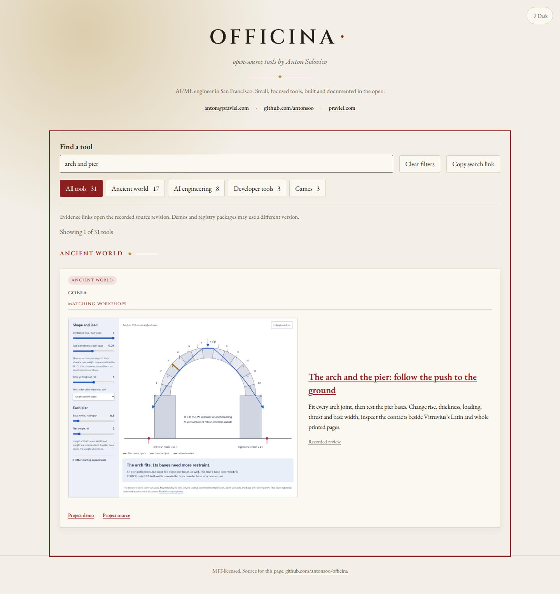

# Local discovery of the arch and pier workshop

Reviewed 2026-10-27. This is a prepared local catalogue addition. Its future
canonical lesson link is redirected explicitly to the reviewed local Gonia
edition during the browser exercise. The exact review commit is checked as a
local git object. No public delivery, public review-page availability or remote
CI result is claimed.

## The learner journey

| Step     | Observed result                                                                                                                                  |
| -------- | ------------------------------------------------------------------------------------------------------------------------------------------------ |
| Search   | `arch and pier`, `latiores`, `cunei`, `coagmenta` and `pier thrust` identify the arch workshop                                                   |
| Share    | Typing leaves the address unchanged; **Copy search link** preserves the query, which reopens in the search field                                 |
| Identify | The workshop has an actual screenshot, an operation-specific summary and its own lesson/review links                                             |
| Operate  | Keyboard widening moves the base width to 1.4 half-spans while pier weight stays 1 W; the previously missed base contacts then fit               |
| Inspect  | The whole-model finder produces a fitted path; joint 4 is opened and its compression contact is read                                             |
| Read     | The actual displayed whole p. 141 blob matches the retained SHA-256, separately from its caption                                                 |
| Review   | The immutable review URL pins Gonia commit `da1e3c9ad5fb626be4363d0a56fdfaba90c5851c`; the exact local blob contains the promised native heading |

The full matrix covers five searches, Chromium/Firefox, and 1440/375 pixels:
**20 journeys**, with no application errors or horizontal document overflow.
The four catalogue screenshots were visually inspected. At mobile width the
preview, title, summary and review link stack in reading order. The thumbnail
is the actual reviewed Gonia section capture, retained without retouching.



[Mobile catalogue](assets/arch-discovery/chromium-375.png) ·
[Native journey receipts](evidence/arch-discovery/review.json).

## Reproduce locally

Serve the production Gonia edition at `/gonia/`, then build and serve Officina
at `/officina/`. For example, with preview ports 4447 and 4448:

```sh
npm run test:arch-local -- http://127.0.0.1:4448/officina/ http://127.0.0.1:4447/gonia/ ../gonia /tmp/officina-arch-review
```

The helper requires the Gonia checkout to resolve the exact pinned review blob.
It redirects only the future canonical arch lesson entry. Other requests and
the emitted canonical link are checked normally; the JSON receipt states the
redirect and the public-verification boundary.

The catalogue source/frontend at `e0c5cf1` was installed from a fresh local
clone with Node 24.21.0. `npm ci`, lint, typecheck, source format check,
all 45 tests and `npm run build` passed. The build command writes **`dist/`**.
The companion Gonia review separately records a fresh installation, an
independent block-equilibrium oracle, offline browser operations and actual
retained artifacts. No new catalogue UI or search behavior was needed.
