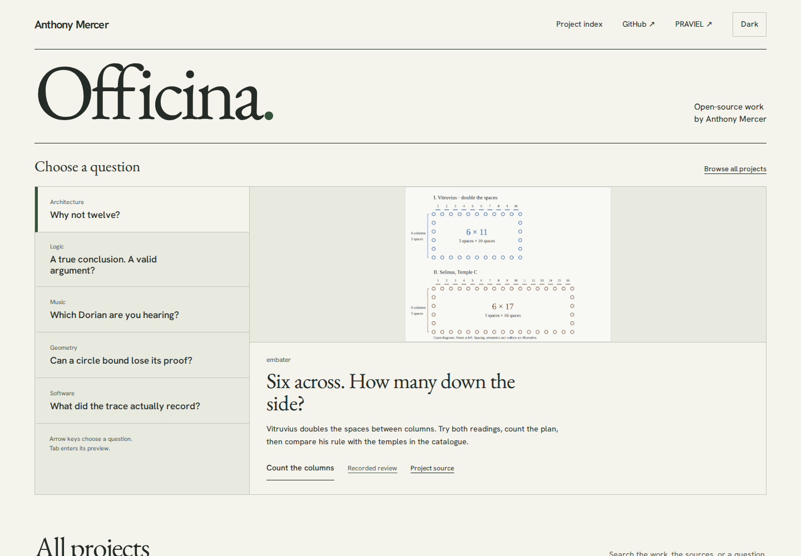

# From a Latin comparison to a measured roof

The architecture question on Officina's opening menu now asks **An eighth as
tall, or an eighth taller?** It leads to Embater's roof workshop: compare a middle
ornament at h/8 with the Latin's h + h/8, read the complete printed page, and keep
the current drawing and its sources. The temple-count lesson remains in the
searchable catalogue and at Embater's existing demo entry.

The new searchable workshop accepts `acroteria`, `ἀκρωτήριον`,
`altiora octava parte`, `tam alta quantum`, `roof ornaments` and the other terms
in `public/projects.json`. Both the menu and the matching workshop use the same
immutable review pin. The preview is a native screenshot of the operated roof,
not a reconstruction of a historical ornament.

[Embater's source/model audit](https://github.com/antonsoo/embater/blob/934432fb2da774e69f398ab000142a48387b3a98/docs/roof-audit.md#try-the-actual-work)
records the source passages, corrected actual geometry, modern conventions,
font reproduction and offline-update behavior. Its portable reading embeds the
roof, full front for context, settings, Latin and English, three complete printed
pages, six font subsets and licenses. No surveyed building or historical
palmette shape is claimed.

## Operated discovery

The [local catalogue to public lesson journey](embater-roof-review/search-local.json)
operates Chromium and Firefox at 1440 and 375 pixels. Each case searches the
Greek/Latin/English terms, shares and reopens the Latin search, follows the
immutable review and lesson by keyboard, tries the misleading h/8 height,
matches the 9h/8 reading, opens and hashes printed page 74, and saves a native
illustrated reading. It opens that script-free file from disk, checks the blue
envelope and complete retained source images, follows its exact reopening link,
and obtains a byte-identical file after controlled offline reload. The raw
review document also matches its git blob.

The [existing eye-vocabulary route](embater-roof-review/existing-eye-route.json)
was replayed against the same newly published Embater edition in both engines
and widths. Its selected part, local detail, zoom, inflected Latin phrase,
checked printed page 71 and native illustrated study remain usable.

The menu's local browser checks cover all five choices by keyboard and native
phone selector, both themes, search preservation, unavailable-thumbnail recovery
and axe accessibility. Ten cases passed. Phone options use short action labels
rather than clipped questions; the actual selected text is measured against the
control width. The twenty local handoffs cover all five public experiments at
both widths in both engines, including native music playback and actual
learner operations. [Handoff receipt](embater-roof-review/menu-local.json).
Publication evidence is recorded separately after completion.

```sh
npm ci
npm run lint
npm run typecheck
npm test
npm run build
```

Serve `dist/` with `npm run preview -- --host 127.0.0.1 --port 4497 --strictPort`, then:

```sh
npm run test:embater-roof -- http://127.0.0.1:4497/officina/ /tmp/roof-discovery
npm run test:questions -- http://127.0.0.1:4497/officina/ /tmp/question-handoffs
```

The lesson and immutable review must be publicly available. Drivers use installed
Playwright Chromium and Firefox. Source/head synchronization, canonical static
bytes, native browser operation and remote CI are separate claims.



## Published catalogue

The source update `3d7644d` was pushed to `main`. The reviewed runtime is from
`083bf8d2e0d5e28b354cc538831e73ac6390a9db`; its [fresh-install inventory](embater-roof-review/clean-build.json)
matches all **108** working build files. Lint, type checks, 45 unit checks and the
production build completed; the ten menu browser cases also passed.

Pages commit `85fb921` was pushed as a fast-forward from the current remote
`gh-pages` tip `32a6ce8`. An initial attempt based on an older local tracking tip
was rejected; it did not replace remote history. The deployment was rebuilt on
the fetched current tip, preserving the publication history and `.nojekyll`.

All [108 canonical files](embater-roof-review/public-files.json) match the captured
clean-build inventory. The [public search journey](embater-roof-review/search-public.json)
passes both engines and widths, including the exact immutable review pin,
source page identity, the native portable reading, reopening its settings and
its byte-identical controlled-offline counterpart. The
[twenty public menu handoffs](embater-roof-review/menu-public.json) operate all
five featured experiments in both engines and widths. The music handoff checks
that the native audio clock advances; the other rooms operate their actual
controls and inspect the resulting state.

The [canonical root, explicit index and catalogue data](embater-roof-review/entries-after-browsers.json)
were fetched again after these browser runs and still matched. This establishes
static-site identity and operated public behavior; it does not claim a registry
release, tag or source CI success. Later documentation-only changes do not alter
the reviewed product bytes.
