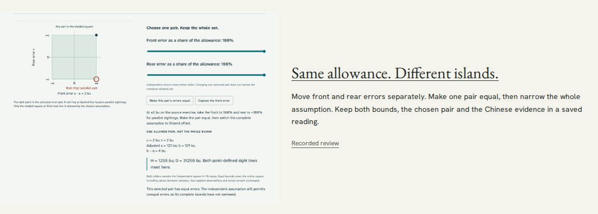

# Discover Haidao's error-pair experiment

Review date: 2026-11-04. Search **shared offset**, **independent errors** or the
source term **相多** within Ancient world. The new matching workshop opens the
actual Haidao uncertainty section and an immutable source review.

The [pinned Haidao audit](https://github.com/antonsoo/haidao/blob/355abcc85c84853d47f2807da08daec7d45c8183/docs/audit.md#try-the-actual-work)
contains the learner operation, exact bounds, source/model limits and reproduced
failure evidence. Its public-delivery review is separate. The existing project
route still opens the original disputed-divisor lesson; its finding now explicitly
qualifies the independent-error assumption. The other 37 catalogue entries are
unchanged.

The new question does not infer an ancient error distribution. Independent mode
allows all error pairs in a square. Making one selected pair equal keeps its
height at 1255 bu without narrowing the unbounded complete family. Changing the
whole assumption to shared additive offsets then fixes the complete height
bound too. Both controls, source readings and native saved files are operable.



[Phone view](assets/haidao-error-pairs-mobile.png). The thumbnail is an actual
Haidao view, with the selected equal pair inside the independent square. No
illustration is presented as a historical instrument drawing.

## Local discovery journey

[The operated receipt](evidence/haidao-error-pairs/local-journeys.json) follows
Chromium and Firefox at 1440 and 375 px through:

1. Ancient world audience selection, three real search terms, explicit copied
   search URL, reload and the matching workshop.
2. Keyboard navigation to the pinned GitHub review, whose anonymous raw bytes
   match its actual source commit, then back to the saved search.
3. Keyboard navigation to the real public lesson and its initial fragment.
4. The equal-pair operation, unchanged independent bounds, shared assumption,
   keyboard adjustment and actual CSV/HTML downloads.
5. A script-free standalone reading with networking unavailable, then the
   public app's offline reload and byte-identical illustrated export.
6. Rechecks of both canonical Haidao entry URLs and the exact catalogue JSON.

The receipt records the final metadata hash and pinned review. Screenshots were
inspected directly. Public publication and clean-build evidence are recorded
separately; this local catalogue receipt is not a deployment claim.

```sh
npm run build
npm run preview -- --host 127.0.0.1 --port 4409 --strictPort
node scripts/haidao-journeys.mjs http://127.0.0.1:4409/officina/ /tmp/officina-haidao-local
```

After publication, pass the canonical HTTPS catalogue URL to the same journey.
The build command is `npm run build`, output `dist/`, base `/officina/`.
The catalogue's existing validation, lint, type checking and 45 tests pass;
no source-CI success is inferred from local checks or a Pages build.
