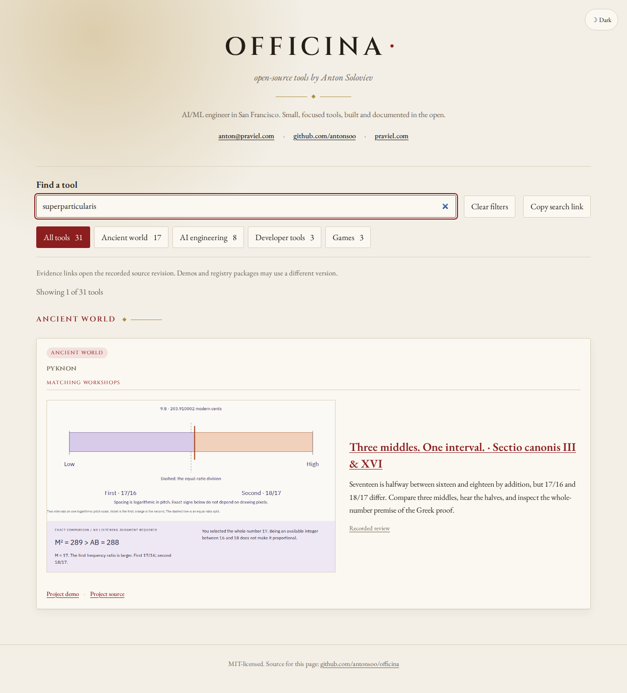
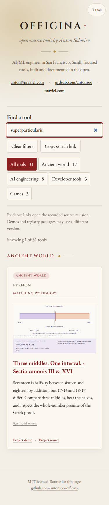

# Discover the proportional-mean workshop

The source word **superparticularis** now finds Pyknon's **Three middles** room,
with its own summary, actual operated diagram and immutable review link. The
query **ἀνάλογον** also identifies the activity. The root project remains
reachable through the separate project links.

The learner compares 17/16 and 18/17, selects the geometric mean 12√2, and then
uses the 4–6–9 control to test the source theorem's superparticular premise.
Seven Greek/Latin/English readings, nineteen word notes and nine complete
1916 pages belong to the lesson; the catalogue explains the activity and links
it directly rather than reproducing the lesson.

Four local-catalogue journeys completed in Chromium 153.0.8010.12 and Firefox
155.0, at 1280 and 375 px. Each used the actual public lesson, selected the
geometric mean and the control with a keyboard, opened XVI's reading and
verified complete page, then followed the pinned GitHub review to its native
**Try the actual work** heading. The source commit is
`35adb9fac29cfcda32c2334cfbd39004cc769481`.

[Local receipt](halves-discovery-2026-10-27/local-journeys.json).
The unchanged catalogue checks passed lint, type checking, forty-five unit
checks and a build. This change adds one workshop to the existing project;
it does not increase the project count.





Reproduce the new journey with a production preview:

```sh
node scripts/workshop-journeys.mjs http://127.0.0.1:4173/officina/ /tmp/officina-halves halves
```

The navigation contexts block service workers, so these checks establish
routing and operation, not offline readiness. Complete offline and portable-file
checks belong to Pyknon's own review. The failed first local attempt used an
expired preview process; its incomplete output is not treated as evidence.
The runner now preserves the original failure if a diagnostic capture also
fails and waits for fonts and paint before search captures.

## Public publication

Source `e93262f` and static gh-pages `3ca30ad` were pushed. All seventy current
canonical build files matched the hosted bytes before and after four completed
public-catalogue journeys. Both browsers at both widths operated the public
lesson and landed on the native pinned review heading. Receipts:
[hosted before](halves-discovery-2026-10-27/hosted-before.json),
[public journeys](halves-discovery-2026-10-27/public-journeys.json),
[hosted after](halves-discovery-2026-10-27/hosted-after.json).

The README now describes the optional activity summary and preview fields and
removes stale fixed counts of workshops/projects. The current metadata remains
the authority for the catalogue contents.
