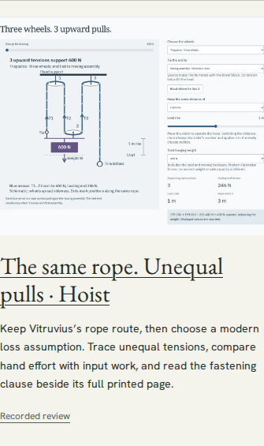

# Discover the unequal-tension hoist

Search [Officina for religatur](https://antonsoo.github.io/officina/?q=religatur#catalogue). The Gonia workshop opens the three-wheel route with a deliberately chosen modern 90% transfer at each turning wheel. The resulting whole-system efficiency is 81.3%, not 90%. This is an instructional loss model, not a measurement of an ancient machine.

The entry uses a screenshot of the actual workshop and links to the [immutable Gonia audit](https://github.com/antonsoo/gonia/blob/e95faa0277497f1e57c601a1518277ad6f347e61/docs/hoist-audit.md#try-the-actual-work). The [asset notice](../ASSET_LICENSES.md) preserves the screenshot's separate terms.

## Local catalogue to public lesson

[Receipt](hoist-discovery/local.json). Chromium 153 and Firefox 155, each at 1440 and 375 px, followed this complete journey:

1. Search independently for `religatur`, `trispastos`, `unequal tensions`, `pulley losses`, and `ὑπομόχλιον`; the specific workshop remains discoverable. Copy the search link and reopen it.
2. Decode the real thumbnail, keyboard-open the actual pinned GitHub review, and read its lesson entry. Independently compare the public raw review with the committed bytes.
3. Keyboard-open the public Gonia lesson. Change the efficiency slider with the keyboard, retain focus, restore 90%, and compare five wheels (813.980937 J input) with three (738.007380 J) for the same 600 N, 1 m lift and arm ratio 2.
4. Open the fastening clause, select `religatur`, and inspect its Latin gloss. Verify the displayed full printed page 227 by SHA-256 against the retained source manifest.
5. Save the native illustrated HTML. Open it as a local file, check all five embedded source pages against their hashes, require the license notice and 81.3% efficiency, reject scripts, and observe zero HTTP requests.
6. Disable browser networking, reload the public lesson, and download a byte-identical study from its saved edition. No owned-page errors occurred.



The local receipt establishes a local catalogue leading to the actual public lesson. It does not establish that the new catalogue itself is public. The public publication follow-up is recorded separately below.

Run from this repository:

```sh
npm run test:hoist -- http://127.0.0.1:4369/officina/ /tmp/officina-hoist-local
```

The script intentionally uses the public destination, its real source-review URL, native downloads and browser networking controls. It does not mock either destination.

## Source and build checks

A clean dependency installation under Node 24.22.1, lint, all 45 existing catalogue/publication unit checks, TypeScript checking and the production build passed. These checks support the change; the operated journey above is the learner-facing evidence. Remote CI and hosted bytes remain separate boundaries.
