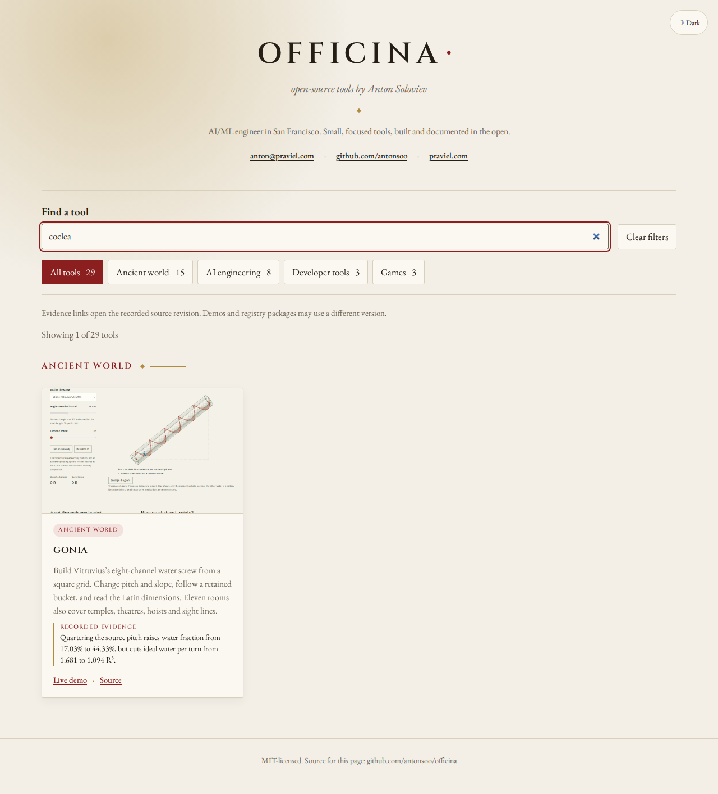
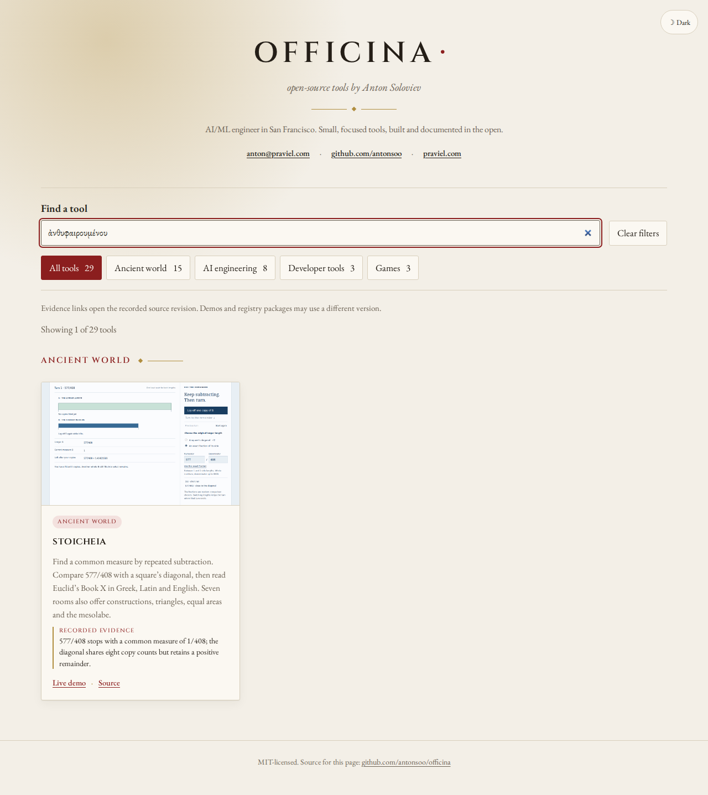

# A common measure and a retained bucket

The catalogue now opens two operated lessons: Euclid's Book X common-measure
workshop and Vitruvius's eight-channel water screw. New-topic searches initially
returned no project; the older `column flute` query also returned none. The
updated index includes the new terms and restores that older alias.

| Search                                                                                     | Public lesson and learner action                                                                                                                                                                                                                                |
| ------------------------------------------------------------------------------------------ | --------------------------------------------------------------------------------------------------------------------------------------------------------------------------------------------------------------------------------------------------------------- |
| `common measure`, `577/408`, `anthyphairesis`, `σύμμετρα`                                  | Fit B into A and turn to the remainder. The fraction stops with measure 1/408; the diagonal keeps a positive remainder after eight matching counts. Read Greek `μηδέποτε` and Latin `nunquam`, then distinguish finite observation from the recurrence argument |
| `water screw`, `coclea`, `sixteen digits`, `spill level`                                   | Follow a strip around the source grid, compare eight starts, alter slope and follow one bucket. At source pitch, 50 degrees leaves outer pockets and 65 degrees retains none. Read the author's sixteen-digit foot beside the original page                     |
| `religatur`, `column flute`, `one twelfth`, `restricted compass`, `two mean proportionals` | Find the same projects and follow their older workshop links                                                                                                                                                                                                    |

The findings are mathematical and conditional. Quartering the source screw's
pitch raises its water fraction from 17.03% to 44.33% but lowers ideal water per
turn from 1.681 to 1.094 outside-radius-cubed units. This is not an efficiency
measurement. The Book X diagonal's unfinished finite run is not itself proof
of nontermination. Each card links an immutable review at the relevant source
heading; the demo and source record are separate boundaries.

Related source phrases keep each entry within the existing 24-term catalogue
schema. Older clients can still parse the current JSON. Source words use the
existing case/accent folding; no new runtime UI or search service is required.

The [local native search record](evidence/measure-and-water-2026-10-25/local-search.json)
covers 113 queries in each browser/width configuration, including earlier terms,
unaccented forms, music discovery, audience narrowing and preserved input focus.
Filtering makes no additional catalogue requests and does not change the URL.

The [eight operated journeys](evidence/measure-and-water-2026-10-25/local-journeys.json)
use Chromium and Firefox at 1280 and 375 pixels, starting in the local production
catalogue and continuing through the public lesson, native downloads and pinned
GitHub source. They operate the source geometry, read the original page, and
follow an earlier hoist or construction-desk link. Fragment placement on GitHub
is observed without manually scrolling the heading into position.

The [twelve immutable native files](evidence/measure-and-water-2026-10-25/portable.json)
cover six HTML/PDF pairs, including the new Book X and screw readings and the
earlier construction, rhythm, grama and hoist packets. Every public file matches
its retained local counterpart. Gzip HTML is decompressed and its identity also
recorded. These source artifacts have their own explicit presets; they are not
substituted for the operated journeys' current-state downloads.

The [thumbnail record](evidence/measure-and-water-2026-10-25/thumbnails.json)
identifies actual 1200-by-750 public-browser captures. Code and original diagrams
are MIT; the linked workshops preserve the source and font notices. The catalogue
still contains 29 projects.

The Book X journey also exposed an ambiguous quiz reply: choosing the correct
**No** produced an opening **Yes** before the correct explanation. The reply
now opens **Correct**, with its [separate public source and 125-file review](https://github.com/antonsoo/stoicheia/blob/519c8991f32e695279f78174e91283eca0cf9ee6/docs/measure-feedback-review.md).

## Public edition

Source main `65df8cd` adds the clean-build receipt after the reviewed change
`bc31d74`. The static branch advanced normally to
`835ce4ff571efa7dfe1bd4da1b4c22e68cc30207`, preserving earlier hashed assets.
The [canonical check](evidence/measure-and-water-2026-10-25/hosted-files.json)
verifies all 63 current files and both entry aliases, with no query cache busting.
The [public journeys](evidence/measure-and-water-2026-10-25/hosted-journeys.json)
repeat all eight lesson/source workflows from the public catalogue. The
[public search pass](evidence/measure-and-water-2026-10-25/hosted-search.json)
repeats 113 queries in each of four browser/width configurations: 452 native searches.

The [clean Node 24 build](evidence/measure-and-water-2026-10-25/clean-build.json)
reproduces all 63 output files. Public source artifacts, static files, native
browser behavior and physical printing remain separate claims.
