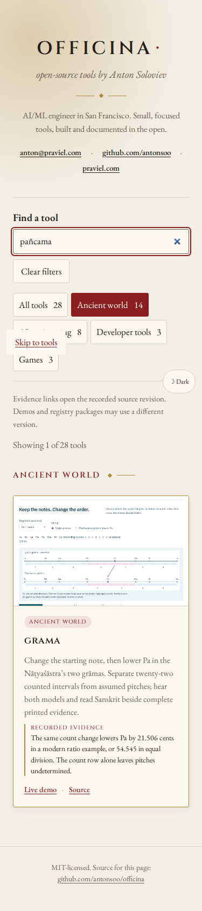

# Make the choice yourself

Officina adds Grāma and features three new workshops in existing repositories.
There are 28 projects. Each of these four entries opens an operation that changes
what a learner can discover, with source reading, explicit model boundaries and
a complete portable record.

| Project   | Operation                                                                                    | Finding                                                                                                                                                   | Historical reading                                                                                            |
| --------- | -------------------------------------------------------------------------------------------- | --------------------------------------------------------------------------------------------------------------------------------------------------------- | ------------------------------------------------------------------------------------------------------------- |
| Stoicheia | Choose circles, lines and crossings for Euclid I.2; keep a wrong crossing, undo and continue | A legitimate intersection can still lie on the wrong branch. Eleven restricted commands supply the incidence chain for the transferred length             | Greek, Heiberg's Latin translation, new English and four full 1883 pages                                      |
| Pyknon    | Keep a six-time foot and change its division from 3+3 to 2+4                                 | Same size, different rhythmic genus; the intermediate-time passage also distinguishes ordinary arithmetic from a rhythmic condition                       | Ten Aristoxenus excerpts, 37 contextual notes, separately attributed Latin parallel and eight full 1861 pages |
| Grāma     | Change the starting note, then lower just Pa; compare two explicit pitch assumptions         | The same one-count operation gives 21.506 cents in the modern ratio example and 54.545 in equal division; the count row alone leaves pitches undetermined | Eight Sanskrit excerpts, IAST and new English, 18 contextual words and eleven full 1888/1894 pages            |
| Gonia     | Keep the wheels and move the tied end; hold either rise or rope take-up fixed                | The same three wheels give three or two upward tensions. Less force trades for more travel; ideal work agrees at load, rope and hand                      | Seven Vitruvius excerpts, 28 Latin/Greek notes, visible editorial layers and five full 1912 pages             |

[Construct I.2](https://antonsoo.github.io/stoicheia/desk.html) ·
[Divide the rhythmic foot](https://antonsoo.github.io/pyknon/rhythm.html) ·
[Change the grāma](https://antonsoo.github.io/grama/) ·
[Move the rope tie](https://antonsoo.github.io/gonia/hoist.html).

## Read or print a saved experiment

These retained examples are actual native downloads with complete source pages.
Download the HTML from its linked file page and open it locally, or use the PDF
for reading and printing. Each is a chosen snapshot; the live workshop lets you
make a different experiment. All eight [public artifact identities](evidence/operated-lessons-2026-10-24/portable-files.json)
match the retained native files.

| Saved experiment                                             | Portable HTML                                                                                                                               | Printable PDF                                                                                                                          |
| ------------------------------------------------------------ | ------------------------------------------------------------------------------------------------------------------------------------------- | -------------------------------------------------------------------------------------------------------------------------------------- |
| I.2, completed eleven-command route                          | [Reading](https://github.com/antonsoo/stoicheia/blob/1855a9594a3a006bf42ae3639281cfe4f992f7de/examples/stoicheia-construction-reading.html) | [PDF](https://github.com/antonsoo/stoicheia/blob/1855a9594a3a006bf42ae3639281cfe4f992f7de/examples/stoicheia-construction-reading.pdf) |
| Six times, 2+4, joined attacks                               | [Reading](https://github.com/antonsoo/pyknon/blob/c91cdc576af85baf113fba182fe89e8d44c9340f/examples/rhythm-reading.html)                    | [PDF](https://github.com/antonsoo/pyknon/blob/c91cdc576af85baf113fba182fe89e8d44c9340f/examples/rhythm-reading.pdf)                    |
| Madhyama, start Re, equal-division counterexample, Sa 220 Hz | [Reading](https://github.com/antonsoo/grama/blob/433620732c1f4fef46947d38cdf677a821cd0102/examples/grama-illustrated-reading.html)          | [PDF](https://github.com/antonsoo/grama/blob/433620732c1f4fef46947d38cdf677a821cd0102/examples/grama-illustrated-reading.pdf)          |
| Five wheels, moving tie, 1 m rise, 1200 N, arm ratio 4       | [Reading](https://github.com/antonsoo/gonia/blob/cc4a123ea05ae5f42dfb4313323ea55dc539ee31/examples/hoist-reading.html)                      | [PDF](https://github.com/antonsoo/gonia/blob/cc4a123ea05ae5f42dfb4313323ea55dc539ee31/examples/hoist-reading.pdf)                      |

These are modern teaching interfaces to identified printed witnesses. The
geometry desk's restricted operation does not establish an ancient physical
compass design. Rhythmic sine markers do not recover a performance accent or
ancient tempo; the finite midpoint is a chosen illustration. The grāma pitch
assumptions are not a recovered ancient tuning or a resolution of the entire
two-vīṇā experiment. The hoist is an ideal parallel-strand analysis, with chosen
SI values and a fixed-tie alteration; it establishes no actual lifting capacity.
The linked reviews and printed pages make these boundaries inspectable.

## Discovery preserves the earlier rooms

Source terms such as `ῥυθμός`, `religatur` and `pañcama`, and English `restricted
compass`, find the new routes. Accent and case folding also allow unaccented
forms. The source-term metadata does not perform morphological language analysis.

Earlier strings, pitch, geometry and architecture topics remain searchable:
Ptolemy's `ἰσότονον`, tetrachords, six tones, the mesolabe's `two mean
proportionals`, bisection, complements, sounding vessels, resonance and flute
cuts. The live interfaces retain the earlier rooms. The replay follows the
new room to the old string trial, sounding-vessel/theatre/transport/fluting rooms
or mesolabe and actually operates them.

## Actual routes and artifacts

The journey script searches by source term and a legacy phrase, decodes the
real thumbnail, follows the demo by keyboard, operates the public lesson and
downloads the actual full HTML reading. It then returns to the catalogue and
follows the immutable source link. The named heading must arrive in the viewport
through native fragment navigation, without a reviewer scroll adjustment.

The new construction route executes eleven commands, checks the wrong branch
and its adaptive hint, changes that branch through Undo and reads the completed
incidence chain. It retains the construction when opening the reading. The
rhythm route checks equal/double genera, reversal, seven's scope, the finite
intermediate example and its Latin parallel. The grāma route changes the first
note, retunes Pa, compares both assumptions and reads the Sanskrit instruction.
The hoist route changes both ties at fixed wheel count, holds rope take-up,
compares hand force/path and reads religatur.

The native packets retain four, eight, eleven and five full source scans,
respectively. Their SHA-256 identities are in the journey receipt. Their own
repositories separately check the portable documents, native models and offline
workflows; a catalogue journey is not substituted for those checks.

All four thumbnails are unedited browser captures. The construction thumbnail
uses six real commands and shows both candidates before the seventh choice.
Its receipt distinguishes the initial demo URL from the captured state URL.
The [thumbnail receipt](evidence/operated-lessons-2026-10-24/thumbnails.json)
retains framing, 1200×750 dimensions and hashes; attribution is in
`public/thumbs/ATTRIBUTION.txt`. Earlier thumbnails remain retained.

```sh
node scripts/ancient-journeys.mjs http://127.0.0.1:4370/officina/ /tmp/operated-lessons
```

[Thirty-six local-catalogue journeys](evidence/operated-lessons-2026-10-24/local-journeys.json)
cover nine projects in Chromium 153 and Firefox 155 at 1280 and 375 px. All recorded
demo and immutable evidence URLs agree with the final catalogue routes. The four
new workshops include actual native packets; the earlier lesson branches are
operated too. Existing lint, formatting, strict typecheck, unit checks, build
and all 32 catalogue browser workflows pass.

[Final native search](evidence/operated-lessons-2026-10-24/local-search.json)
checks 74 source/legacy queries in each of four browser/width configurations:
296 native searches. Focus and the catalogue URL remain unchanged; no additional
catalogue-data request occurs. English `music` finds Grāma, Pyknon, Sammu,
Pnigeus and Shiguzhai; the audience filter still narrows the result.



The [isolated Node 24 review](evidence/operated-lessons-2026-10-24/clean-build.json)
runs the documented `npm install`, lint, formatting, typecheck, all 40 unit checks,
build and 32 browser workflows. The lockfile stays unchanged; all 57 build files
are byte-identical to the working Node 26 build. The exact `npm run dev` command
starts at localhost:5173, where the [native search workflow](evidence/operated-lessons-2026-10-24/development-search.json)
passes in both browsers and widths. This source archive is an isolated local
installation, not yet a claim about a fresh public clone.

## Public catalogue publication

The updated [public catalogue](https://antonsoo.github.io/officina/) is verified.

| Boundary                  | Observed identity or result                                                                                                                                                                                  |
| ------------------------- | ------------------------------------------------------------------------------------------------------------------------------------------------------------------------------------------------------------ |
| Reviewed source           | `08192c03579e36cd774ea39439a63e2c547eeec4`                                                                                                                                                                   |
| Pages branch              | `7f861f0ce69513734f18ea9d63e194754bb11e28`                                                                                                                                                                   |
| Pages configuration       | API reports legacy publication from `gh-pages`, root `/`                                                                                                                                                     |
| Canonical hosted bytes    | All 57 current files match SHA-256 identities, with matching directory checks before and after                                                                                                               |
| Hosted native search      | 296 source/legacy queries, five music projects, retained input focus and audience narrowing; no additional catalogue-data requests                                                                           |
| Hosted complete journeys  | 36 routes across nine projects, Chromium 153 and Firefox 155, 1280 and 375 px; actual controls and files, earlier-room navigation and the complete pinned heading visible through native fragment navigation |
| Fresh public source clone | HTTPS clone of the reviewed source; Node 24.22.0, `npm ci`, `npm run build`; all 57 output files byte-identical                                                                                              |
| Saved study artifacts     | All eight pinned public HTML/PDF files match the native retained files                                                                                                                                       |

[Publication record](evidence/operated-lessons-2026-10-24/publication.json) ·
[Canonical files](evidence/operated-lessons-2026-10-24/hosted-files.json) ·
[Public search](evidence/operated-lessons-2026-10-24/hosted-search.json) ·
[Public journeys](evidence/operated-lessons-2026-10-24/hosted-journeys.json) ·
[Public clone](evidence/operated-lessons-2026-10-24/public-clone.json).

The latest-build API returned HTTP 404, so no API build-status result is claimed.
The Pages configuration, pushed branch, actual hosted bytes and browser behaviour
are independently observed above. Historical hashed assets remain retained for
already-open pages and are outside the current 57-file inventory. Later
documentation-only commits retain these observations without changing runtime
inputs. This publishes a static catalogue; it is not a registry release or a
claim that hosted CI jobs ran.
