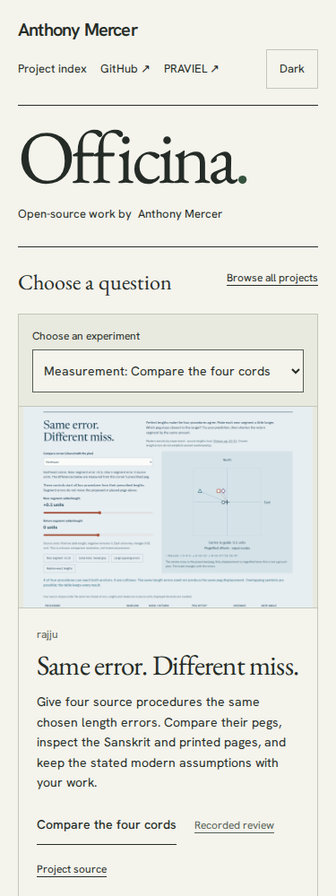

# Discover four cord procedures under the same length errors

Reviewed on 2026-11-02. Rajju's public workshop asks whether the same chosen
cord errors move four source procedures to the same peg. This catalogue entry
opens the experiment directly, rather than leaving the learner at its general
field plan. The source recipes are historical; this sensitivity comparison and
its precision assumptions are explicitly modern.

## Discovery

The opening question menu adds **Do four cords miss the same way?** under
Measurement. Arrow keys reach it on desktop; the native phone selector exposes
the same choice. Its thumbnail is an actual 1440 by 1000 public Chromium
capture, without a source scan. The [capture receipt](rajju-cord-review/thumbnail.json)
identifies the URL and image hash. Its [license](../public/thumbs/rajju-errors-LICENSE.txt)
is retained separately from Officina's MIT code.



Search `cord errors`, `lakṣaṇa` or `measurement errors` to reveal the named
workshop. Explicitly copy the search link, reopen it and follow the workshop
with the keyboard. The Rajju umbrella study and other routes remain available.
The new review link is pinned to the exact source revision
`cf3126955c2c61179a13700c48326856f136e274`, whose implementation and
[public-byte review](https://github.com/antonsoo/rajju/blob/fcb2af6/docs/audit-publication.md)
were independently operated before this entry was published.

## Operated handoffs

```sh
npm run test:questions -- http://127.0.0.1:4420/officina/ /tmp/officina-questions
```

The [local-catalogue receipt](rajju-cord-review/local.json) records 24 question
handoffs (all six questions in Chromium and Firefox at 1440 and 375 pixels) and
four search/share/reopen journeys. Destinations are actual public projects.
Each review's raw bytes are compared with the pinned local Git object.

Each cord handoff moves the near error from 0.10 to 0.11 with the keyboard,
keeps control focus, selects opposing errors to make the 5-12-13 procedure
unreachable, then restores 0.10 and reads the 0.260013-unit miss. It opens printed
p. 11 and hashes the displayed image bytes, saves a real illustrated HTML
reading, opens that native downloaded file from disk and verifies both its
result and Required Notice. The saved file makes no HTTP requests.

The catalogue handoff contexts block service workers, so these are not PWA
installation tests. Rajju's own public/browser and locally injected failure
reviews separately cover saved-edition integrity, damaged-cache repair,
worker takeover and offline navigation. A catalogue screenshot alone establishes
none of those behaviours.

The broader catalogue browser suite also exposed an existing assertion that
searched only project descriptions. The actual filter includes workshop text:
`TRACE` correctly finds both Gonia's unequal-tension workshop and Tracelens.
The assertion now checks those concrete results. Menu checks cover all six
routes in both themes, including phone action-label width.

## Publication and public replay

Source `59c144d` was pushed to `main`; the clean Node 24.22.1 build was
published by a fast-forward `gh-pages` commit `144cbd2`. Its 113 files were
identical to the Node 26.7.0 working build. The retained
[build inventory](rajju-cord-review/clean-build.json) identifies every file.
Local lint, type checking, formatting, 45 unit checks and 56 Chromium/Firefox
browser checks passed. No remote CI run was observed in the separate query.

The [public replay](rajju-cord-review/public.json) completed all 24 menu
handoffs and four search/share journeys against the canonical public catalogue.
All eight cord handoffs produced native illustrated files that opened without
HTTP requests. The public menu captures matched the locally reviewed captures.
After those browser journeys, the [hosted receipt](rajju-cord-review/hosted.json)
verified all 113 canonical files and both entry aliases against the clean build.
Rajju's own 30 hosted files and directory entry were checked again separately.
