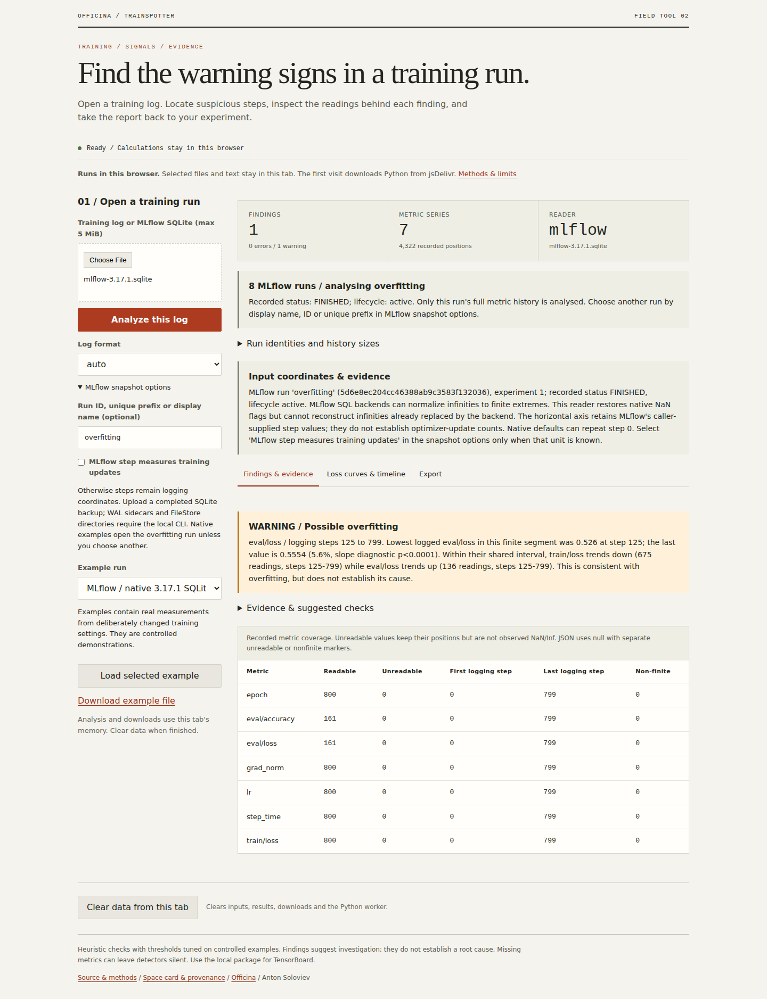

# Read original MLflow histories in the public workbench

Trainspotter's public workbench refused the actual MLflow SQLite captures with
“Upload a .json, .jsonl, or .csv log.” The local package already read their full
histories. The browser now runs that same pinned reader against a self-contained
snapshot, without a tracking server or MLflow SDK in the app.

Choose a native SQLite example or upload a snapshot. Select a display name,
exact run ID or unique prefix. The inventory retains all recorded identities,
statuses and history sizes, while the report identifies the selected run.
The original readings, clocks and non-finite flags survive into JSON and
portable HTML reports.

| Decision or input | Public behavior |
| --- | --- |
| MLflow 2.17.2 / 3.17.1 native SQLite | Read the selected run's full history |
| Ordinary MLflow step | Keep a logging coordinate; do not infer optimizer updates |
| Explicit training-update declaration | Change timing interpretation without changing observations |
| Recorded `step_time` metric | Retain the directly recorded timing measurement |
| Duplicate display name | Refuse ambiguity and preserve the previous report |
| WAL-mode main file | Refuse a potentially incomplete snapshot before SQLite opens it |
| Repeated diagnostic steps or finite values above 1e100 | Retain the workbench's explicit refusal policy |

The original databases are byte-identical to the
[native SDK captures](https://github.com/antonsoo/trainspotter/tree/0a8fa452f4ca182e62cd5c0832dd3ed3cc2af113/studies/mlflow-native).
They replay measured MLP/W&B metrics and authored reader controls into real
local stores. MLP timestamps are controlled, and the W&B clocks retain native
millisecond precision. These are not new training runs or production incidents.
A separate SDK capture retains 86 authored observations, including a native NaN,
duplicate names and a deleted run.

The native replay compares every accepted value, step, wall time and non-finite
marker with the SDK's captured `get_metric_history` output. Eighteen accepted
analyses and eighteen explicit refusals passed in both the workspace and the
freshly installed flat Space. An actual committed WAL update demonstrates why
uploading only a main file can lose evidence. The tested read-only backup
procedure retains it and changes journal mode on the copy, leaving the source
store intact.

[The public workbench](https://antonsoloviev-trainspotter.static.hf.space/) is
published at Hub commit `f47a4950399e2f3e18cdc6dfc6281cb75088f36f`.
[Its adapter, original inputs and replay study](https://huggingface.co/spaces/antonsoloviev/trainspotter/tree/f47a4950399e2f3e18cdc6dfc6281cb75088f36f/evidence/mlflow-browser)
are public. All 33 engine files match the immutable public source pin,
fresh installed package and browser archive. The actual worker reports
Python 3.14.2, NumPy 2.4.6 and SQLite 3.39.0.

The [retained verification receipts](assets/mlflow-browser-2026-10-17/) include
the clean install, installed/native replay, browser downloads and full hosted
file checks. All four apps passed clean checks and their ordinary browser
workflows. Only Trainspotter was republished. Four fresh Chromium/Firefox
contexts at desktop and 375 pixels saved 76 public downloads, matched complete
JSON reports to native output, and made no analysis HTTP requests after loading.
All 32 downloaded HTML reports match native installed output after normalizing
only their single generation-time field. Ambiguous and WAL uploads preserve
the previous JSON and HTML bytes. Clear removes the new options and report state.

All 64 immutable Hub files, corresponding served assets, the manifest and root
entrypoint matched the tested bundle before and after public use. The other
three public Space commits remained unchanged. The example download link also
now follows the selected scenario; it previously always downloaded the default
JSON. The run inventory supports keyboard focus and horizontal scrolling.

This publication accepts self-contained SQLite snapshots up to 5 MiB, with
50,000 metric rows, 1,000 runs and the existing selected-output limits. It does
not import WAL sidecars or FileStore directories; those remain local-package
workflows. Runtime loading and recreation after Clear require asset downloads.
The source engine remains pinned to `0a8fa452f4ca182e62cd5c0832dd3ed3cc2af113`;
no registry release or tag was made.
