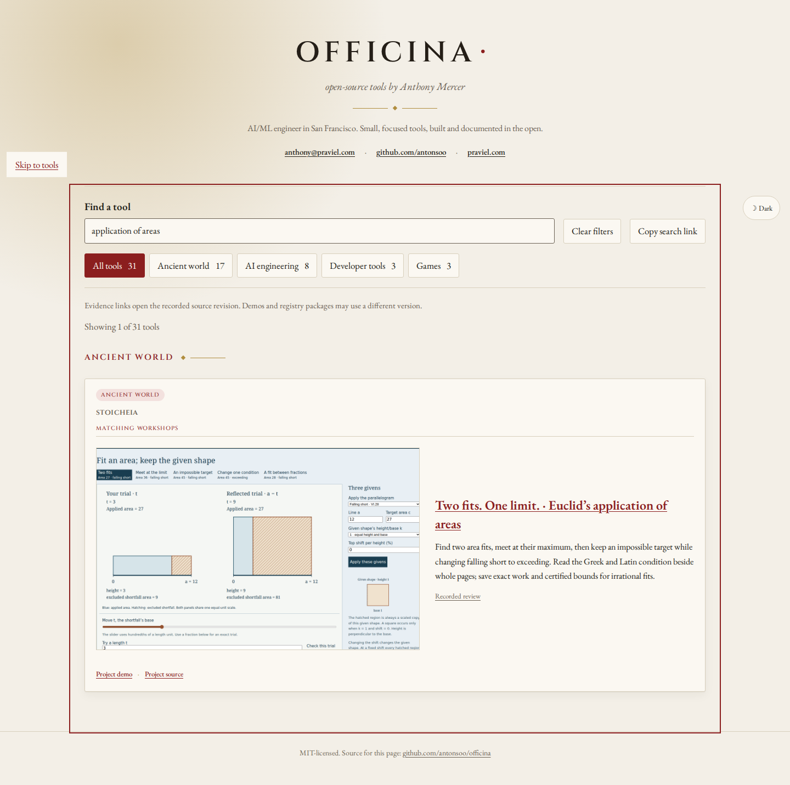

# Discover and operate Euclid’s area conditions

The catalogue now connects an English topic and the Greek/Latin construction
words to Stoicheia’s **Two fits. One limit.** workshop. The given line and target
are not enough: a prescribed similarity shape and falling-short/exceeding
condition determine which constructions are possible.

| Query | Workshop route | Source operation |
| --- | --- | --- |
| `application of areas` | `stoicheia/areas.html#ar-bench` | Reflect the two equal-area trials |
| `ἐλλεῖπον` | same | Inspect the falling-short area ceiling |
| `ὑπερβάλλον` | same | Change to exceeding; fit target 45 at 3 |
| `deficiens` | same | Read VI.28’s Greek/Latin condition |
| `excedens` | same | Read VI.29’s changed condition |

The English title, nineteen source/topic aliases, activity summary and real
workshop screenshot live in `public/projects.json`. The recorded review points
to feature commit `2bb7c8d48e406dcccacdee8f0b1f86b7a39ebd37` and its
`docs/areas-review.md#try-the-actual-work` heading. The complete source pages,
modern model boundaries, native artifacts and direct review belong to Stoicheia.

## Actual local journey

[Twenty completed journeys](review.json) cover Chromium and Firefox at 1440 and
375 pixels for all five queries. They type the search without changing the
address, explicitly make and reopen a shared search link, find the specific
workshop, and use keyboard navigation to open its recorded review and lesson.

The pinned review is loaded from the exact local Git blob and rendered through
its future canonical review link. The future canonical lesson entry redirects
to the local production build. This makes the full journey inspectable without
asserting that either new URL has already been published.

Inside the lesson each journey reflects 3 to 9 while retaining area 27; keeps
target 45 visible as impossible when falling short; changes to exceeding and
fits it at 3; reads the changed Greek/Latin condition; then opens printed Greek
p.166. The displayed image’s actual bytes hash to the retained source manifest.
The catalogue and lesson stay within the viewport in both widths. Page errors
remain empty in the reviewed journeys.



[Phone capture](../../docs/assets/areas-discovery-phone.png).

## Reproduce

Build and serve Stoicheia at `http://127.0.0.1:4368/stoicheia/`. In Officina run
`npm ci`, `npm run build`, and
`npm run preview -- --host 127.0.0.1 --port 4369 --strictPort`.
Then, from another terminal in Officina:

```bash
node scripts/areas-local.mjs http://127.0.0.1:4369/officina/ http://127.0.0.1:4368/stoicheia/ ../stoicheia /tmp/areas-discovery
```

The normal catalogue validation, lint, type checking, 45 tests and build passed.
The thumbnail keeps the catalogue’s 1200:750 aspect ratio and comes from an
unmodified 1280×800 browser capture of the real bench.

A fresh archive of catalogue feature commit
`2537340c16bc819fc81ec0337ad2ff1aa09bdbaf` passed `npm ci`, build, lint, type
checking and all 45 tests on Node 24.22.1. Every output file matches the reviewed
local build byte-for-byte. The [fresh-build inventory](clean-build.json) records
the filenames, sizes and digests. The paired Stoicheia archive separately passed
its complete checks and independently reproduced the lesson’s built files.

## Publication boundary

This is a local prepared addition. No push, hosted update, public raw-blob
availability or remote CI execution is claimed. `HOUSE_STANDARDS.md` reserves
publication for the coordinator. The project’s existing published circle
workshop and other catalogue routes retain their own evidence.
