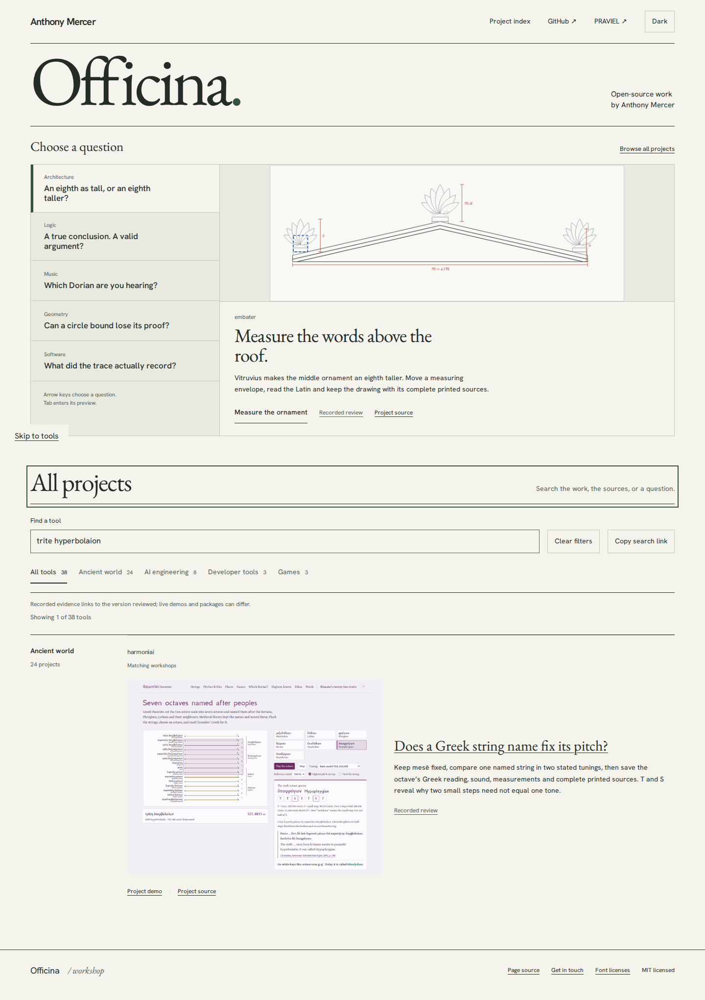
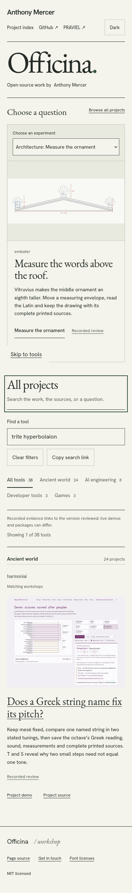

# Does a Greek string name fix its pitch?

The named-pitch instrument was reachable from Harmoniai's own navigation but
absent from the catalogue's workshop results. The catalogue now exposes the
specific experiment, a real screenshot and a source-pinned review, alongside
the existing Dorian and unequal-lowering routes.

Search [trite hyperbolaion](https://antonsoo.github.io/officina/?q=trite+hyperbolaion#tools).
The Greek τρίτη ὑπερβολαίων, its transliteration with or without macrons,
“reference pitch” and “23.460 cents” reach the same workshop. Keep mesē at
330 Hz: the selected named string measures 521.4815 Hz in the ratio model and
523.8423 Hz in the equal-step model. Save the illustrated octave to retain the
Greek reading, pitch measurements, sound and complete printed evidence.

The review link pins Harmoniai source `a7bc754`, including its actual public
edition audit. It does not use a moving branch URL. A Node 24.22.1 clean install
and build matches the working build exactly; lint, catalogue validation, strict
types and 45 tests pass. All **109 canonical hosted files** match the reviewed
build. The metadata deployment is a normal-history commit, `336981c`.

Chromium and Firefox at 1440 and 375 pixels searched five terms, copied and
reopened the real search link, followed the review with the keyboard, opened
the experiment with the keyboard, changed the tuning model, and downloaded an
actual illustrated study. The three embedded source JPEGs were independently
hashed against Harmoniai's retained manifest. No page errors or document overflow
were observed. The canonical catalogue entry was checked after every journey.
The native files' hashes and the immutable review's anonymous raw-byte comparison
are retained in [public.json](public.json).




[Clean build](build.json) · [Hosted identities](hosted.json) ·
[Publication boundary](publication.json).

Reproduce after `npm ci` and `npm run build`:

```sh
node scripts/harmoniai-pitch-journeys.mjs https://antonsoo.github.io/officina/ /tmp/harmoniai-pitch-discovery
```

This verifies catalogue discovery and the linked public lesson. Harmoniai's
own source, audio, update, repair and artifact checks remain separate records
in its pinned review. No package release or remote-CI success is asserted here.
