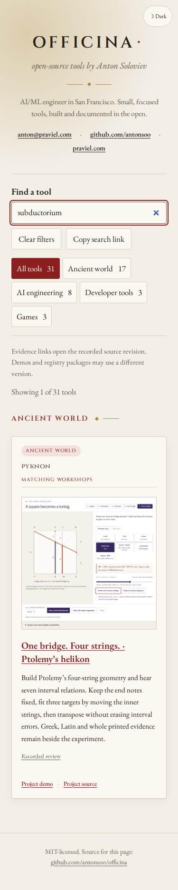
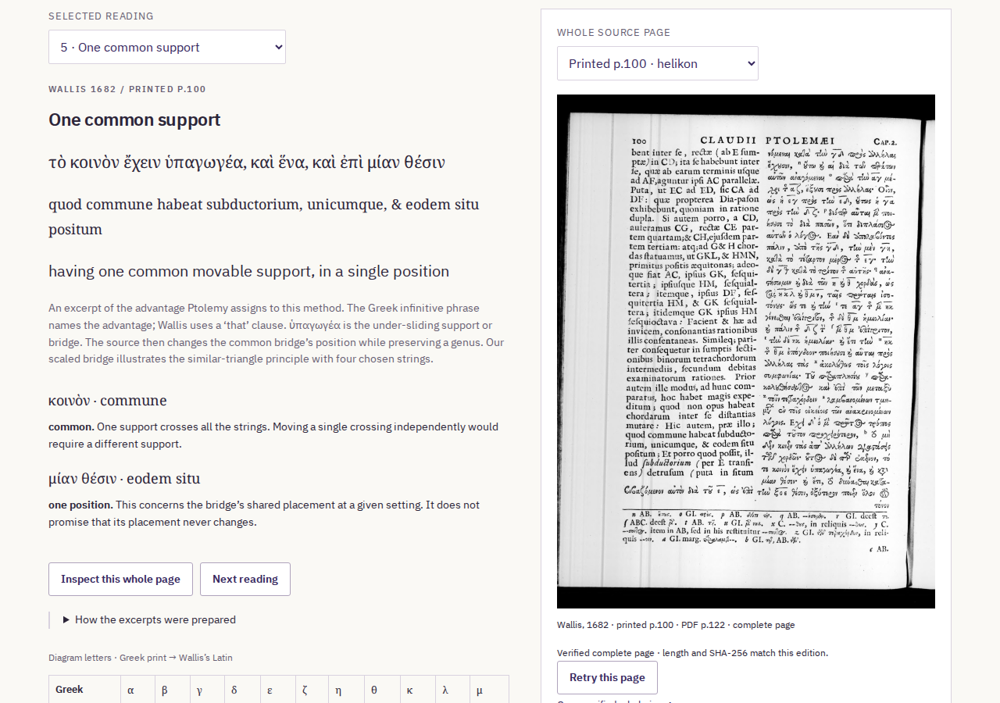

# Public helikon discovery

The [Latin source-word search](https://antonsoo.github.io/officina/?q=subductorium)
now leads to the working public helikon. This publication review is separate
from the earlier local replay, whose `publicDeliveryVerified: false` flags
remain accurate records of its original scope.

| Surface                        | Identity or result                                                                                                  |
| ------------------------------ | ------------------------------------------------------------------------------------------------------------------- |
| Catalogue source               | `c1bfe3b88b6d735cdf4b37e6c548505477601c1a`                                                                          |
| Catalogue Pages commit         | `a7b8e44316712b499d53f6303caa315c13b52854`                                                                          |
| Public files                   | All 74 current build files match canonical HTTPS bytes                                                              |
| Actual discovery               | Chromium and Firefox, 1280 px and 375 px; four complete journeys                                                    |
| Lesson operation               | Keyboard fit to 1/7 and 1/4, transpose to 240 Hz, start/stop sound, complete source page                            |
| Pinned review                  | Native GitHub navigation reaches the visible requested heading at Pyknon `d141e0dca839ac627fb50af52031283844a49f2e` |
| Source and deployment boundary | Main and Pages commits pushed with the owner's explicit authorization                                               |

[Canonical file identities](hosted-files.json) and
[continuous browser journeys](hosted-journeys.json) retain the results.
The journeys make no local redirects or GitHub-page substitutions. Typing
remains local, with no additional catalogue fetch and no silent URL rewrite.
The current build's directory entry is checked before and after inventory.





The public search and operation screenshots were inspected. The source-language
thumbnail is the retained actual helikon screenshot. File and browser success
do not establish CI success or a registry release. Pyknon's independent public
offline and export review is in its `docs/helikon-publication.md`.

Replay from the source checkout:

```sh
node scripts/workshop-journeys.mjs https://antonsoo.github.io/officina/ /tmp/helikon-discovery helikon
```
