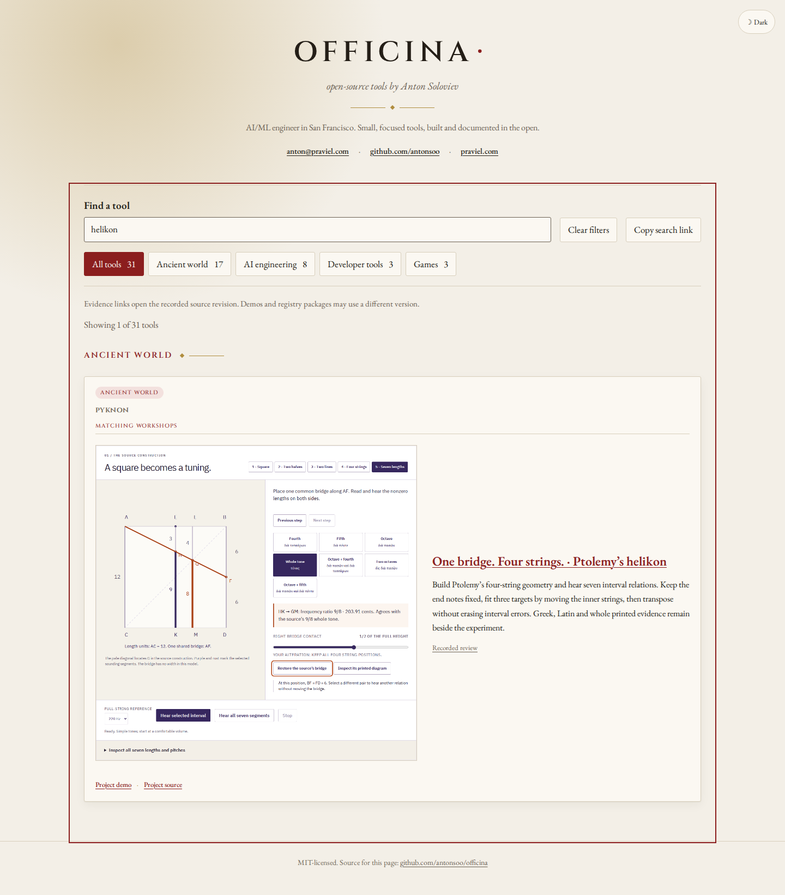

# Find and operate Ptolemy’s helikon

Officina’s Pyknon card now has a direct helikon workshop route. English name,
Greek source word and Latin source word searches reach the same operable
instrument room, rather than requiring a learner to infer the room from the
project’s main demonstration. The existing project demonstration remains the
musical-sign desk.

| Search                             | Workshop                  | Initial source reading         |
| ---------------------------------- | ------------------------- | ------------------------------ |
| `helikon` / `helicon`              | One bridge. Four strings. | Common support, p.100          |
| `ὑπαγωγέα` / accentless `υπαγωγεα` | One bridge. Four strings. | Greek “common movable support” |
| `subductorium`                     | One bridge. Four strings. | Wallis’s corresponding Latin   |

Additional aliases identify the straight bridge, four strings, parallel and
equal-pitch strings, Ptolemy and _Harmonics_ II.2. The row includes its own
summary and an unchanged screenshot from the actual reviewed workshop.

## What was operated

The [twelve local browser journeys](local-review.json) cover Chromium and Firefox
at 1440 and 375 pixels, for English `helikon`, accentless Greek `υπαγωγεα` and
Latin `subductorium`. Each journey:

1. Types into the native catalogue search without rewriting the address.
2. Uses **Copy search link**, opens that explicit link and restores the query.
3. Follows the actual keyboard-operated workshop link to the real local
   production build of Pyknon.
4. Fits the two inner strings at **1/7** and **1/4** of the width. Shortens the
   common sounding scale to **11/12**, raising the left note to **240 Hz** while
   all four target ratios remain exact.
5. Reads the selected Greek and Latin and verifies the actual complete p.100
   image against the source manifest’s SHA-256.
6. Checks the review link’s exact commit and heading against the actual local
   immutable Git blob. No public review page is substituted or claimed.

The review is pinned to Pyknon commit
`d141e0dca839ac627fb50af52031283844a49f2e`,
`docs/helikon-review.md#try-the-actual-work`. It includes the learner workflow,
source/model boundaries, original downloads, real browser/PDF/audio evidence,
clean install and publication handoff.



[Phone catalogue](chromium-375-catalogue.png) ·
[Desktop operation](chromium-1440-operation.png) ·
[Phone operation](chromium-375-operation.png) ·
[Firefox catalogue](firefox-1440-catalogue.png).
The actual screenshots were inspected. The thumbnail is an unchanged copy of
the reviewed source-board screenshot; it is a preview, while the workshop keeps
all measured values and controls available as text.

## Reproduce locally

Build both repositories. Serve Officina on 4363 and Pyknon on 4362, then run
from Officina with the Pyknon checkout as the third positional argument:

```sh
npm run test:helikon-local -- http://127.0.0.1:4363/officina/ http://127.0.0.1:4362/pyknon/ ../pyknon /tmp/officina-helikon-review
```

The driver explicitly redirects only the future canonical helikon entry to
the local lesson origin. The source image, controls and sharing actions are
actual browser operations. The pinned review is read with `git show`, rather
than claiming its future GitHub URL was served. The receipt records this
boundary on every journey.

`npm run lint`, `npm run format:check`, `npm test` (45 tests),
`npm run check:catalogue` and `npm run build` passed locally. A clean-install
receipt is retained with the final handoff. The normal public
`workshop-journeys.mjs` reviewer also contains a helikon case for the eventual
published journey; it was not run against an unpublished canonical page.

## Publication boundary

This is a prepared local addition. No source push or Pages deployment was
attempted. The new canonical lesson and pinned review were not verified
publicly. Publish the reviewed Pyknon source and its matching build first,
then this catalogue build. Hosted bytes and actual public learner journeys
require a separate review after publication.
