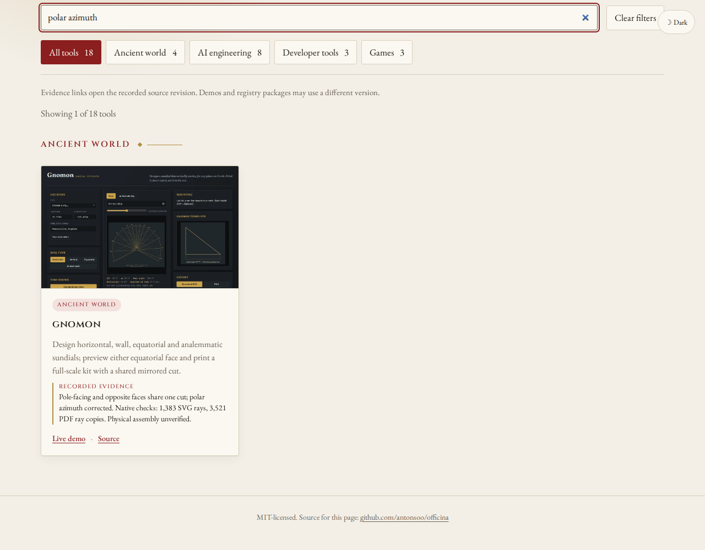
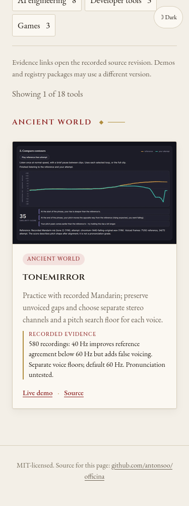

# Find the physical construction and voice-range workflows

The published catalogue returned no cards for four concrete tasks now
supported by Gnomon and ToneMirror. Two descriptions and evidence links
now make them discoverable while retaining the existing dial types,
recorded Mandarin, unvoiced-gap and stereo-channel search terms.

| Search | Card | Pinned evidence |
|---|---|---|
| opposite face | gnomon | Both outside views, one physical cut and aligned two-face kit |
| polar azimuth | gnomon | Independently measured correction to polar hour directions |
| pitch search floor | tonemirror | Separate reference/attempt floors; 60 Hz default retained |
| 40 Hz | tonemirror | 580-recording tradeoff: more low reference agreement and more false voicing |

The Gnomon finding retains the boundary between digital geometry and
physical assembly. ToneMirror retains the false-voicing cost and lack of
pronunciation validation. The links use full immutable commits; the
[linked-source receipt](results/linked-source.json) compares both study
READMEs with their actual Git objects.

[Before](results/before.json): 16 real searches on the hosted catalogue,
across Chromium/Firefox and 1280/375 px, all returned zero cards.
[Local replay](results/local.json): the same searches return exactly the
intended card, keep working offline without replacement catalogue requests,
and have no page errors or horizontal overflow. Card action links pass
hit tests. [Eight actual keyboard navigations](results/local-links.json)
reach the expected pinned GitHub study headings with HTTP 200.

Only the two catalogue records change. Existing demo destinations, package
links, thumbnails and other records retain their values. A separate Vite
patch updates the development editor launcher from 7.3.6 to 7.3.7; the
[upstream advisory](https://github.com/advisories/GHSA-587h-7wmj-h5pm)
identifies the fixed branch version. This does not establish a vulnerability
in the production static site.

```sh
npm ci
npm run build
npm run preview -- --host 127.0.0.1 --port 4195 --strictPort
# In another shell:
node scripts/replay-native-workflow-search.mjs \
  http://127.0.0.1:4195/officina/ /tmp/physical-voice-search after \
  studies/physical-and-voice-discovery/queries.json
node studies/expert-and-schema-discovery/follow-links.mjs \
  http://127.0.0.1:4195/officina/ /tmp/physical-voice-search/links.json \
  studies/physical-and-voice-discovery/headings.json
```

The keyboard replay now accepts a base URL, output path and heading map;
its original expert/schema defaults remain available. Source publication,
hosted bytes and public navigation are verified separately after deployment.

The [clean-install receipt](results/verification.json) records Node 24.22.0,
38 unit cases, 32 browser workflows, lint, typecheck, format and the 41-file
production build. The [clean search replay](results/clean.json) repeats all
16 queries with identical results and screenshots. Both the new eight-link
flow and the original expert/schema defaults reach their intended headings.





ToneMirror screenshots contain the existing credited thumbnail, derived from
Wolfdog (2019)'s *FourMandarinTones.ogg*. These screenshots are distributed
under [CC BY-SA 4.0](https://creativecommons.org/licenses/by-sa/4.0/);
[original source and transformation details](../../public/thumbs/ATTRIBUTION.txt).
