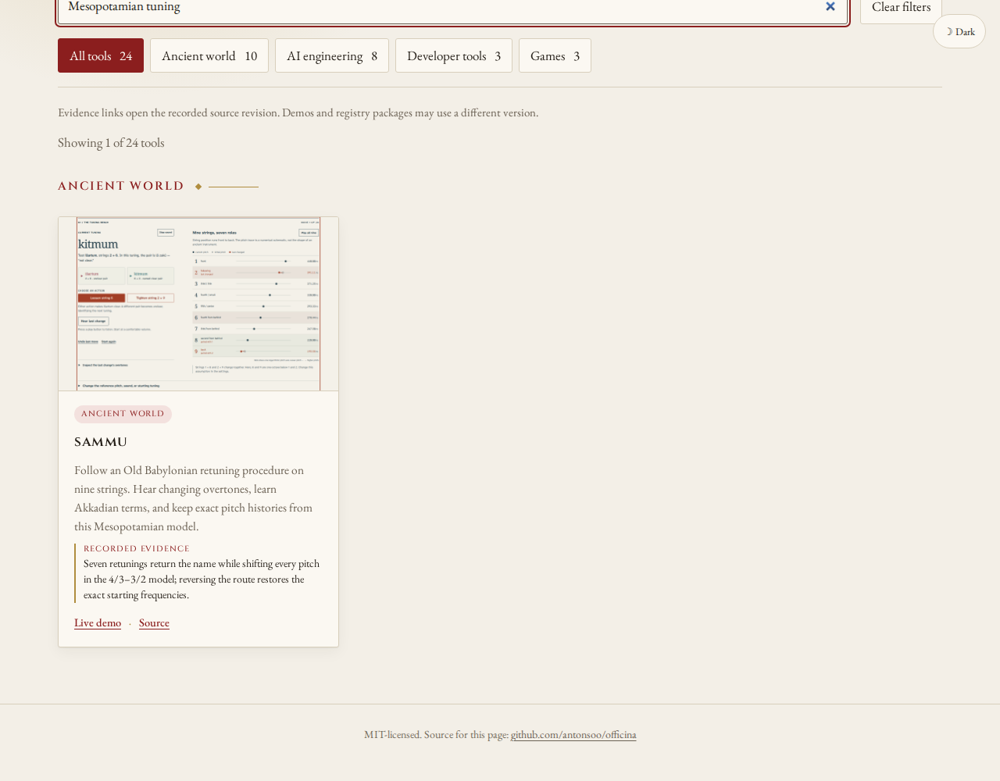
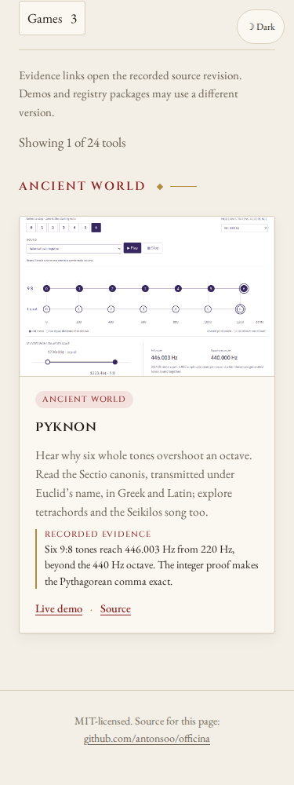

# Find the retuning workshop and octave proof

Sammû is a new source-based Mesopotamian retuning workshop. Pyknon now also reads and plays the Sectio canonis argument about six whole tones and an octave. The catalogue adds the first and directs the existing Pyknon entry to the second, with actual application screenshots and immutable review links. The earlier Seikilos image and its attribution remain available.

| Search              | Project | Live destination                                                   |
| ------------------- | ------- | ------------------------------------------------------------------ |
| Akkadian retuning   | sammu   | Seven retunings, a returning name and shifted pitches              |
| Babylonian strings  | sammu   | Same cycle experiment, with nine playable strings nearby           |
| Mesopotamian tuning | sammu   | Source reconstruction and an explicit 4/3–3/2 realization          |
| six whole tones     | pyknon  | Step six in the audible octave comparison                          |
| Sectio canonis      | pyknon  | Greek/Latin proof and exact integer progression                    |
| Euclid octave       | pyknon  | A work transmitted under Euclid’s name, with attribution qualified |
| Pythagorean comma   | pyknon  | The small exact excess beyond the octave                           |

The previous public catalogue returned no cards for these seven queries. The changed local catalogue returns exactly the intended card in Chromium and Firefox at desktop and 375 px widths; filtering also works with the context offline. Source changes are catalogue data, two new original screenshots, attribution notes and a small replay-helper adjustment accepting immutable `blob/<commit>/docs/` evidence alongside existing `tree/<commit>/studies/` links.

Reproduce against a production preview:

```sh
npm run build
npm run preview -- --host 127.0.0.1 --port 4387 --strictPort
node scripts/replay-native-workflow-search.mjs http://127.0.0.1:4387/officina/ /tmp/officina-retuning after studies/retuning-and-octaves-discovery/queries.json
node studies/expert-and-schema-discovery/follow-links.mjs http://127.0.0.1:4387/officina/ /tmp/officina-retuning/links.json studies/retuning-and-octaves-discovery/headings.json
```

The review links identify their source commits and source locations. Sammû’s ratios and sound colours remain labelled as a realization; the card does not turn them into recovered ancient frequencies. The source review of Sectio canonis retains its authorship qualification.

[Before: 28 public searches](results/before.json) · [Local: 28 searches and offline filtering](results/local.json) · [Eight keyboard evidence links](results/local-links.json) · [Eight keyboard demo links](results/local-demos.json). Demo navigation checks the actual requested state: seven loosening moves and a 2048/2187 shift in Sammû, and step six with 446.003/440.000 Hz readouts in Pyknon.





The new thumbnails and these two screenshots contain original programmatic diagrams and explanatory prose, with no article figure, tablet photograph or third-party recording. Their screenshot content is MIT; existing earlier thumbnail notices remain in the catalogue attribution file.

## Published catalogue

Source `8df88cd` and Pages `7dc61b4` publish the two entries. A fresh installation passes lint, the 38 existing unit cases, strict typecheck and build; its 48 files are byte-identical to the reviewed working build ([build record](results/build.json)). [All 48 canonical hosted files](results/public-bytes.json) match that build. Forty-five prior files remain byte-identical; only `projects.json` and attribution text change, alongside the two new thumbnails.

[Public search replay](results/public.json) repeats all 28 searches and offline filtering. [Eight public keyboard evidence links](results/public-links.json) reach the intended pinned GitHub headings. [Eight public keyboard demo links](results/public-demos.json) reach the requested running experiments, including their numerical state. [Publication receipt](results/publication.json).
