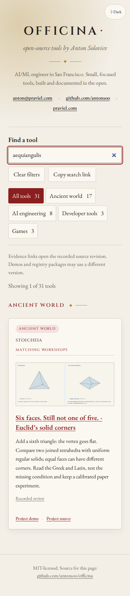
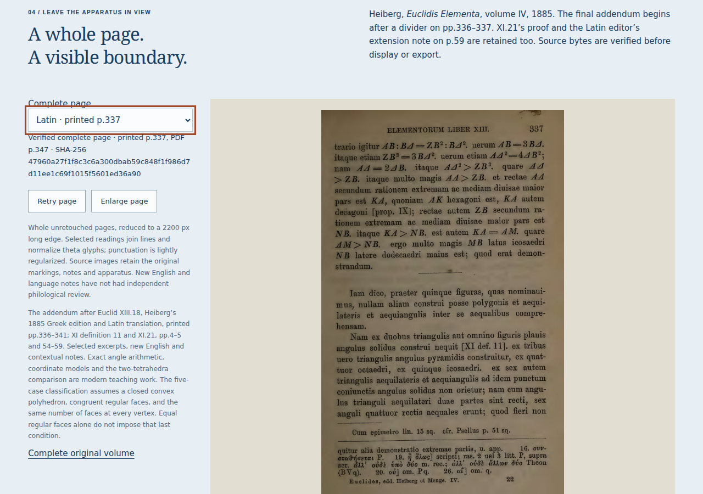

# Find the condition behind five solids

The [source-word search](https://antonsoo.github.io/officina/?q=aequiangulis)
leads directly to **Six faces. Still not one of five.** The route starts with
three triangles at a vertex, so a learner can add the sixth, see the flat
obstruction, then inspect the three-face tips and four-face belt vertices of
the same six-faced bipyramid.

| Surface                    | Identity or observation                                                                                                                      |
| -------------------------- | -------------------------------------------------------------------------------------------------------------------------------------------- |
| Published catalogue source | `27059118f2c7b9a169bd54ac4310d80db345fb96`                                                                                                   |
| Pages branch               | `d75a6e5abd12a7b9fd7d2c1579eb0ddea23d2ca7`                                                                                                   |
| Pinned review source       | Stoicheia `276131d7b17a61db2cd2a48fab92aba2de3f72ab`                                                                                         |
| Public file identity       | All 75 current build files match canonical HTTPS bytes                                                                                       |
| Independent clean build    | Node 24 fresh install, lint/format/45 tests/catalogue/types/build; all 75 files match                                                        |
| Public learner journeys    | Chromium and Firefox at 1280 px and 375 px; four continuous search/workshop/pinned-review journeys                                           |
| Actual operation           | Add sixth triangle; inspect a tip and belt; compare conditional four/six vertex counts with the actual five; inspect the complete Latin page |
| Complete source page       | Printed p.337, SHA-256 `47960a27f1f8c3c6a300dbab59c848f1f986d7d11ee1c69f1015f5601ed36a90`                                                    |

The public reviewer follows real canonical links without local redirects or
GitHub-page substitutions. Native keyboard navigation reaches the visible
**Try the actual work** heading at the immutable source revision. Typing keeps
the address unchanged and makes no additional catalogue fetch. The catalogue
thumbnail is a byte-identical actual browser screenshot of the two models.

[Complete public journeys](hosted-journeys.json) ·
[canonical file identities](hosted-files.json) ·
[independent clean installation](clean-build.json).





The actual search and operation screenshots were inspected. The primary lesson
also contains Greek and Latin source selections, and the metadata includes
`ἴσων ἀλλήλοις`, `solidus angulus` and English geometric terms. The retained
continuous public matrix specifically uses the Latin `aequiangulis` query.

This catalogue review does not establish CI or registry-release success.
Stoicheia's separate `docs/solids-publication.md` records its public offline,
native-download, PDF and complete-build verification, including the boundaries
between failed source workflows and the actual Pages service.

Replay:

```sh
node scripts/workshop-journeys.mjs https://antonsoo.github.io/officina/ /tmp/solids-discovery solids
```
